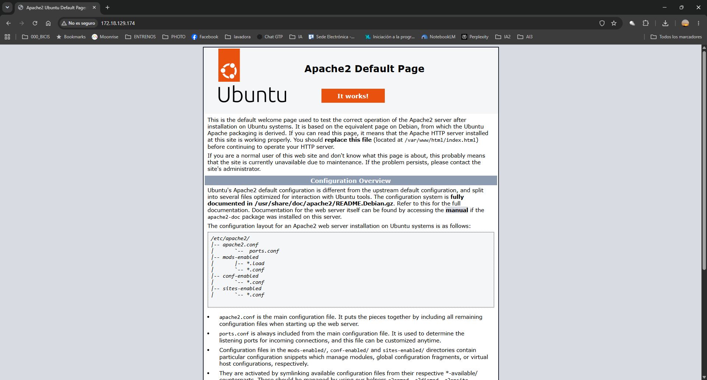

# Guía completa: instalación y configuración de un servidor web Apache en Ubuntu
ls -R
Esta guía explica cómo instalar, configurar, comprobar y mantener un **servidor web Apache** en Ubuntu. Está pensada para una persona que nunca ha montado un servidor web y necesita seguir el procedimiento paso a paso, copiando y pegando los comandos.

## Índice

1. [Introducción](#1-introducción)
2. [Requisitos previos](#2-requisitos-previos)
3. [Instalación](#3-instalación)
   - [3.1 Instalar el paquete](#31-instalar-el-paquete)
   - [3.2 Gestionar el servicio](#32-gestionar-el-servicio)
   - [3.3 Si tu Ubuntu no tiene systemd (WSL)](#33-si-tu-ubuntu-no-tiene-systemd-wsl)
4. [Estructura de archivos](#4-estructura-de-archivos)
5. [Publicar contenido](#5-publicar-contenido)
   - [5.1 Una página sencilla](#51-una-página-sencilla)
   - [5.2 Permisos](#52-permisos)
6. [Configuración de un sitio virtual](#6-configuración-de-un-sitio-virtual)
   - [6.1 Crear el sitio](#61-crear-el-sitio)
   - [6.2 Activar el sitio](#62-activar-el-sitio)
7. [Módulos](#7-módulos)
8. [Cortafuegos y seguridad básica](#8-cortafuegos-y-seguridad-básica)
9. [Comprobación](#9-comprobación)
10. [Resolución de problemas](#10-resolución-de-problemas)
11. [HTTPS con certificado autofirmado](#11-https-con-certificado-autofirmado)
12. [Referencias](#12-referencias)

---

## 1. Introducción

**Apache HTTP Server** (paquete `apache2` en Ubuntu) es un servidor web de código abierto. Su función es recibir peticiones HTTP de los navegadores y devolver páginas web.

Cuando escribes una dirección en el navegador ocurre lo siguiente:

1. El navegador envía una petición al servidor, normalmente por el puerto **80**.
2. Apache busca el archivo solicitado en su directorio de documentos.
3. Apache devuelve el archivo (o un error) al navegador.

Al terminar la guía serás capaz de:

- Instalar y gestionar el servicio Apache.
- Publicar tus propias páginas.
- Crear un sitio virtual.
- Localizar y corregir los errores más comunes.

## 2. Requisitos previos

- Ubuntu 20.04 o superior, instalado en una máquina virtual, en un equipo físico o mediante *WSL* en Windows.
- Un usuario con permisos de `sudo`.
- Conexión a Internet para descargar los paquetes.
- Un navegador web para las comprobaciones.

> **Cómo usar los comandos:** ejecuta los bloques de código **de uno en uno**. El primer comando con `sudo` te pedirá la contraseña, y si pegas varios bloques seguidos, las líneas siguientes podrían interpretarse como la contraseña. Si prefieres pegar varios a la vez, ejecuta antes `sudo -v` para introducir la contraseña.

## 3. Instalación

### 3.1 Instalar el paquete

1. Actualiza la lista de paquetes disponibles.
2. Instala Apache (la opción `-y` responde "sí" a la confirmación).
3. Comprueba que el servicio está activo.

```bash
sudo apt update
sudo apt install -y apache2
sudo systemctl status apache2
```

Si todo ha ido bien, verás el estado `active (running)`. Para salir de la pantalla de estado pulsa la tecla `q`.

### 3.2 Gestionar el servicio

| Comando | Función | Cuándo usarlo |
|---------|---------|---------------|
| `sudo systemctl start apache2` | Inicia el servicio | Si está parado |
| `sudo systemctl stop apache2` | Detiene el servicio | Para mantenimiento |
| `sudo systemctl restart apache2` | Reinicia el servicio completo | Tras instalar o quitar módulos |
| `sudo systemctl reload apache2` | Recarga la configuración sin cortar conexiones | Tras editar archivos de configuración |
| `sudo systemctl enable apache2` | Arranque automático con el sistema | Para que inicie solo |
| `sudo systemctl disable apache2` | Desactiva el arranque automático | Si no se quiere en el inicio |

### 3.3 Si tu Ubuntu no tiene systemd (WSL)

En algunas instalaciones de WSL, `systemctl` no funciona porque `systemd` no está activado (se nota porque da un error al ejecutarlo). Hay dos soluciones.

**Opción A: activar systemd.** Edita el archivo de configuración de WSL:

```bash
sudo nano /etc/wsl.conf
```

Añade estas líneas, guarda con `Ctrl+O` (la letra O), confirma con `Enter` y sal con `Ctrl+X`:

```ini
[boot]
systemd=true
```

Después, en **PowerShell de Windows**, ejecuta `wsl --shutdown` y vuelve a abrir Ubuntu.

**Opción B: usar `service`.** Sustituye `systemctl` por `service` con este orden:

| En lugar de... | Usa... |
|----------------|--------|
| `sudo systemctl start apache2` | `sudo service apache2 start` |
| `sudo systemctl stop apache2` | `sudo service apache2 stop` |
| `sudo systemctl restart apache2` | `sudo service apache2 restart` |
| `sudo systemctl reload apache2` | `sudo service apache2 reload` |
| `sudo systemctl status apache2` | `sudo service apache2 status` |

> **Nota:** `enable` y `disable` no tienen equivalente con `service`; en ese caso Apache hay que iniciarlo a mano cada vez que abras WSL.

## 4. Estructura de archivos

Apache en Ubuntu reparte su configuración en varios archivos y directorios. Conocerlos evita perder tiempo buscando.

| Ruta | Contenido | Para qué sirve |
|------|-----------|----------------|
| `/etc/apache2/apache2.conf` | Configuración principal | Ajustes generales; incluye al resto de archivos |
| `/etc/apache2/ports.conf` | Puertos de escucha | Define en qué puertos escucha Apache (80, 443) |
| `/etc/apache2/sites-available/` | Sitios disponibles | Archivos de configuración de cada sitio |
| `/etc/apache2/sites-enabled/` | Sitios activos | Enlaces a los sitios activados |
| `/etc/apache2/mods-available/` | Módulos disponibles | Módulos que se pueden activar |
| `/etc/apache2/mods-enabled/` | Módulos activos | Enlaces a los módulos activados |
| `/etc/apache2/conf-available/` | Configuraciones adicionales | Ajustes generales opcionales |
| `/etc/apache2/conf-enabled/` | Configuraciones activas | Enlaces a las configuraciones activadas |
| `/var/www/html/` | Documentos web | Páginas del sitio por defecto |
| `/var/log/apache2/` | Registros | `access.log` y `error.log` |

> **Importante:** los archivos de los directorios `*-enabled/` son *enlaces simbólicos* a los de `*-available/`. No se editan directamente: se usan los comandos `a2ensite`/`a2dissite` (sitios), `a2enmod`/`a2dismod` (módulos) y `a2enconf`/`a2disconf` (configuraciones). Como regla: **`available` es lo que existe y `enabled` es lo que está funcionando**.

## 5. Publicar contenido

### 5.1 Una página sencilla

Los archivos que se guardan en `/var/www/html` se publican automáticamente. Crea una página de prueba con este bloque completo (cópialo entero, de `sudo tee` hasta `EOF`):

```bash
sudo tee /var/www/html/hola.html > /dev/null <<'EOF'
<!DOCTYPE html>
<html lang="es">
<head>
  <meta charset="UTF-8">
  <title>Mi primera página</title>
</head>
<body>
  <h1>Hola desde Apache</h1>
  <p>Este servidor funciona correctamente.</p>
</body>
</html>
EOF
```

Comprueba que se ha creado:

```bash
cat /var/www/html/hola.html
```

### 5.2 Permisos

Apache se ejecuta con el usuario `www-data`, así que debe poder leer los archivos. Una configuración habitual es:

```bash
sudo chown -R www-data:www-data /var/www/html
sudo find /var/www/html -type d -exec chmod 755 {} \;
sudo find /var/www/html -type f -exec chmod 644 {} \;
```

Los directorios llevan `755` (se pueden recorrer) y los archivos `644` (se pueden leer).

## 6. Configuración de un sitio virtual

Un *sitio virtual* (VirtualHost) permite alojar varios sitios web en el mismo servidor. Apache decide cuál mostrar según el nombre que lleva la petición (`ServerName`).

### 6.1 Crear el sitio

1. Crea el directorio del sitio.
2. Crea su página de inicio.
3. Ajusta los permisos.
4. Crea el archivo de configuración.

```bash
sudo mkdir -p /var/www/misitio
```

```bash
echo "<h1>Bienvenido a misitio</h1>" | sudo tee /var/www/misitio/index.html
```

```bash
sudo chown -R www-data:www-data /var/www/misitio
```

Crea ahora el archivo de configuración con este bloque (cópialo entero, de `sudo tee` hasta `EOF`):

```bash
sudo tee /etc/apache2/sites-available/misitio.conf > /dev/null <<'EOF'
<VirtualHost *:80>
    ServerName misitio.local
    ServerAdmin webmaster@localhost
    DocumentRoot /var/www/misitio

    ErrorLog ${APACHE_LOG_DIR}/misitio_error.log
    CustomLog ${APACHE_LOG_DIR}/misitio_access.log combined
</VirtualHost>
EOF
```

El contenido del archivo es el siguiente. Fíjate en que `CustomLog` lleva **dos argumentos** (el archivo y el formato `combined`), y que ambos van en la misma línea:

```apache
<VirtualHost *:80>
    ServerName misitio.local
    ServerAdmin webmaster@localhost
    DocumentRoot /var/www/misitio

    ErrorLog ${APACHE_LOG_DIR}/misitio_error.log
    CustomLog ${APACHE_LOG_DIR}/misitio_access.log combined
</VirtualHost>
```

### 6.2 Activar el sitio

1. Activa el nuevo sitio.
2. Comprueba la sintaxis.
3. Recarga el servicio.

```bash
sudo a2ensite misitio.conf
sudo apache2ctl configtest
sudo systemctl reload apache2
```

> **Aviso:** ejecuta siempre `apache2ctl configtest` antes de recargar. Debe responder `Syntax OK`. Si hay un error de sintaxis, el servicio puede dejar de funcionar.

El sitio por defecto (`000-default.conf`) **se mantiene activo**: responde a `http://localhost`, mientras que `misitio` responde cuando la petición lleva el nombre `misitio.local`. Así los dos sitios conviven. Para ver los sitios virtuales activos:

```bash
sudo apache2ctl -S
```

## 7. Módulos

Apache es *modular*: las funciones extra se añaden activando módulos.

| Módulo | Función | Comando de activación |
|--------|---------|-----------------------|
| `rewrite` | Reescribe URLs | `sudo a2enmod rewrite` |
| `ssl` | Permite HTTPS | `sudo a2enmod ssl` |
| `headers` | Modifica cabeceras HTTP | `sudo a2enmod headers` |
| `deflate` | Comprime las respuestas para que la web cargue más rápido | `sudo a2enmod deflate` |
| `expires` | Indica al navegador cuánto tiempo puede guardar en caché cada archivo | `sudo a2enmod expires` |
| `status` | Muestra el estado del servidor en `/server-status` (por defecto, solo desde el propio equipo) | `sudo a2enmod status` |
| `proxy` | Permite que Apache reenvíe peticiones a otro servidor | `sudo a2enmod proxy` |

Flujo habitual para activar, desactivar y listar módulos:

```bash
sudo a2enmod rewrite
sudo systemctl restart apache2
sudo apache2ctl -M | grep rewrite
sudo a2dismod rewrite
sudo systemctl restart apache2
```

- `a2enmod` activa un módulo y `a2dismod` lo desactiva. El ejemplo activa `rewrite`, comprueba que aparece cargado y lo vuelve a desactivar.
- Tras activar o desactivar módulos hay que **reiniciar** Apache (`restart`, no basta con `reload`).
- `apache2ctl -M` lista los módulos cargados; con `| grep rewrite` se filtra solo el que interesa.

Para saber qué módulos hay instalados y cuáles están activos:

```bash
ls /etc/apache2/mods-available/
ls /etc/apache2/mods-enabled/
```

`mods-available` contiene todos los módulos que se pueden activar, y `mods-enabled` solo los que están funcionando (enlaces simbólicos, como en los sitios). Si un módulo aparece solo en `available`, existe pero está desactivado.


> **Cuidado:** Ubuntu protege los módulos *esenciales* (por ejemplo `autoindex`, `dir` o `mime`). Si intentas desactivar uno con `a2dismod`, muestra una advertencia y pide escribir una frase de confirmación. **No la escribas**: responde cualquier otra cosa y la operación se cancela (`Aborting`). Desactivar un módulo esencial puede romper Apache.

## 8. Cortafuegos y seguridad básica

Si el equipo usa `ufw`, hay que permitir el tráfico web:

```bash
sudo ufw status
sudo ufw allow 'Apache'
```

`ufw allow` solo tiene efecto si el cortafuegos está activo (`Status: active`). Si aparece `inactive`, no hay nada que permitir. Si responde `command not found`, `ufw` no está instalado (es lo habitual en WSL): puedes instalarlo con `sudo apt install -y ufw`, pero no es necesario para esta guía y no afecta al funcionamiento de Apache.

> **Cuidado:** no actives `ufw` (`sudo ufw enable`) en un servidor al que te conectas por SSH sin permitir antes el puerto 22 con `sudo ufw allow ssh`; podrías perder el acceso.

Recomendaciones básicas de seguridad:

- Mantén el sistema **actualizado** con `sudo apt update && sudo apt upgrade`.
- No des permisos `777` a los directorios web.
- Desactiva los sitios y módulos que no uses.
- Revisa periódicamente los registros de `/var/log/apache2/`.

> **Nota:** en WSL el cortafuegos `ufw` suele estar desactivado, por lo que este apartado no se puede comprobar.

---

## 9. Comprobación

1. Abre el navegador y accede a `http://localhost`. Debe aparecer la página por defecto de Apache.
2. Accede a `http://localhost/hola.html` para ver tu página de prueba.
3. Comprueba el sitio virtual indicando su nombre con `curl`, sin tocar ningún archivo del sistema:

```bash
curl -H "Host: misitio.local" http://localhost
```

La respuesta debe ser `<h1>Bienvenido a misitio</h1>`.




> **Nota (WSL):** si `http://localhost` no abre la página en el navegador de Windows, usa la dirección IP de Ubuntu. Se obtiene con `hostname -I` (por ejemplo `172.18.129.174`) y se escribe como `http://172.18.129.174`. Esa IP puede cambiar cada vez que se reinicia WSL.

**Opcional: abrir `misitio.local` en el navegador.** Para ello hay que asociar el nombre a la dirección `127.0.0.1`:

- **Linux o máquina virtual:** añade la línea `127.0.0.1 misitio.local` al archivo `/etc/hosts` (con `sudo nano /etc/hosts`).
- **WSL con navegador en Windows:** añade esa misma línea al archivo `C:\Windows\System32\drivers\etc\hosts` (editado como administrador).

Después podrás abrir `http://misitio.local` en el navegador.

## 10. Resolución de problemas

| Problema | Causa probable | Solución |
|----------|----------------|----------|
| La página no carga | Servicio parado | `sudo systemctl start apache2` |
| Error al recargar (`AH00526` u otro) | Sintaxis incorrecta en una directiva | Revisar la línea que indica el error y ejecutar `sudo apache2ctl configtest` |
| Aviso `AH00558` (nombre de servidor) | Falta un `ServerName` global; es inofensivo | Ver el bloque de código de abajo |
| Error 403 (Forbidden) | Permisos incorrectos | Revisar propietario, permisos y los directorios padre |
| Error 404 (Not Found) | Archivo inexistente o ruta incorrecta | Comprobar el nombre y el `DocumentRoot` |
| El servicio no arranca | Puerto 80 ocupado | `sudo ss -tlnp \| grep :80` |
| `systemctl` da error en WSL | `systemd` desactivado | Ver el apartado 3.3 |
| No se accede desde otro equipo | Cortafuegos bloqueando | `sudo ufw allow 'Apache'` |

Para diagnosticar cualquier fallo, consulta el registro de errores:

```bash
sudo tail -n 20 /var/log/apache2/error.log
```

Para el error **403**, comprueba los permisos de cada tramo de la ruta. Apache necesita permiso de entrada (`x`) en **todos** los directorios padre, no solo en el último:

```bash
namei -l /var/www/html/hola.html
```

Para eliminar el aviso **AH00558** al ejecutar `configtest`:

```bash
echo "ServerName localhost" | sudo tee /etc/apache2/conf-available/servername.conf
sudo a2enconf servername
sudo systemctl reload apache2
```
## 11. HTTPS con certificado autofirmado

HTTPS cifra la comunicación entre el navegador y el servidor. Para pruebas se puede usar un **certificado autofirmado**: funciona igual, pero el navegador avisará de que no lo emite una autoridad de confianza. Para un sitio real se usaría un certificado de una autoridad, como Let's Encrypt.

| Archivo | Ruta | Función |
| --- | --- | --- |
| Certificado | `/etc/ssl/certs/misitio.crt` | Parte pública, la que recibe el navegador |
| Clave privada | `/etc/ssl/private/misitio.key` | Parte secreta, nunca se comparte |

### 11.1 Generar el certificado

1. Activa el módulo `ssl`.
2. Genera el certificado y la clave, válidos durante un año.

```bash
sudo a2enmod ssl
```

```bash
sudo openssl req -x509 -nodes -days 365 -newkey rsa:2048 \
  -keyout /etc/ssl/private/misitio.key \
  -out /etc/ssl/certs/misitio.crt \
  -subj "/CN=misitio.local"
```

### 11.2 Crear el sitio seguro

Crea el archivo de configuración con este bloque (cópialo entero, de `sudo tee` hasta `EOF`):

```bash
sudo tee /etc/apache2/sites-available/misitio-ssl.conf > /dev/null <<'EOF'
<VirtualHost *:443>
    ServerName misitio.local
    DocumentRoot /var/www/misitio

    SSLEngine on
    SSLCertificateFile /etc/ssl/certs/misitio.crt
    SSLCertificateKeyFile /etc/ssl/private/misitio.key

    ErrorLog ${APACHE_LOG_DIR}/misitio_ssl_error.log
    CustomLog ${APACHE_LOG_DIR}/misitio_ssl_access.log combined
</VirtualHost>
EOF
```

### 11.3 Activar y comprobar

```bash
sudo a2ensite misitio-ssl.conf
sudo apache2ctl configtest
sudo systemctl restart apache2
```

Comprueba que responde por HTTPS (la opción `-k` acepta el certificado autofirmado):

```bash
curl -k --resolve misitio.local:443:127.0.0.1 https://misitio.local
```

La respuesta debe ser `<h1>Bienvenido a misitio</h1>`. Si usas `ufw`, permite el puerto 443 con `sudo ufw allow 'Apache Secure'`.
## 12. Referencias

- [Documentación oficial de Apache 2.4](https://httpd.apache.org/docs/2.4/)
- [Ubuntu Server: Apache](https://ubuntu.com/server/docs/web-servers-apache)
- [Guía de sintaxis Markdown](https://www.markdownguide.org/basic-syntax/)
